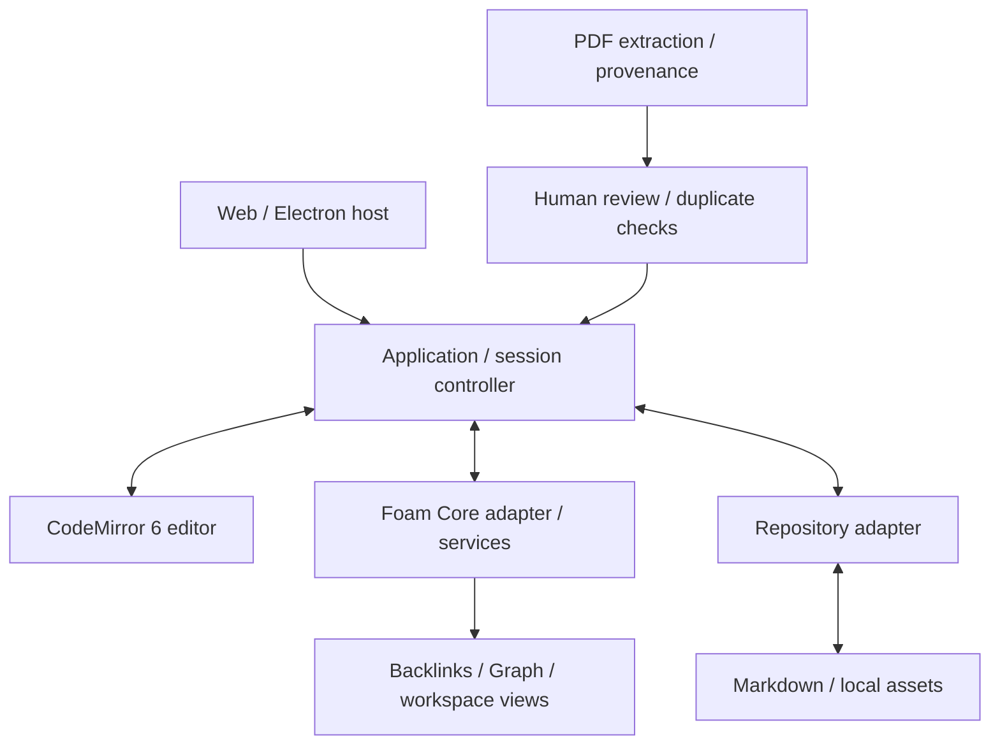

# Foam Editor product plan

This is the user-approved product direction, shared by GitHub Copilot, OpenAI Codex and ChatGPT. Milestones below are goals unless explicitly marked complete. See [PROJECT_STATUS.md](PROJECT_STATUS.md) for implementation evidence and current limits; [AGENTS.md](../AGENTS.md) governs repository work.

## Product vision

Foam Editor is a Markdown editor and document management system with an Obsidian-like experience, reusing Foam Core, embeddable in Web/Electron, and extensible for regulation/legal documents, PDF ingestion and visualization.

## Five pillars

1. **Obsidian-like editor.** CodeMirror 6 with Live Preview, interactive Markdown, headings, lists, tasks, inline images, Wikilinks, smooth editing, safe automatic saving and no silent data loss.
2. **Reuse Foam Core.** Navigation, Autocomplete, Backlinks, Graph, workspace and linked notes use existing Foam services rather than rewritten equivalents.
3. **Regulation/legal document management.** Typed YAML metadata, document status and dates, references/replaces/implements relations, filtering and visualization. Derived dates alone never establish legal validity.
4. **Multi-document PDF ingestion.** Split a large PDF into multiple documents, extract content and metadata, require human review before generating Markdown notes, preserve evidence/provenance and protect against duplicate imports.
5. **Portable Web/Electron integration.** Separate editor, application/session controller, Foam Core, repository adapters and PDF pipeline. Cross-device sync is a separate integration scope.

## MVP v0.1 milestones

| Milestone | Outcome                                                                                                                     | Checkpoint                      |
| --------- | --------------------------------------------------------------------------------------------------------------------------- | ------------------------------- |
| M0        | Safe real-file workspace synchronization and Wikilink navigation, with Save/Discard/Cancel fallback and conflict protection | Complete; see status evidence   |
| M1        | Automatic saving and seamless navigation; safety fallback reserved for exceptional situations                               | Next; auto-save not implemented |
| M2        | Workspace and CodeMirror Live Preview usability, real notes, editor behavior and local image/asset handling                 | Planned                         |
| M3        | Accessible Wikilink Autocomplete, Backlinks, Graph and workspace browsing, reusing Foam Core                                | Planned                         |
| M4        | End-to-end acceptance, tests, README and an independently usable MVP demonstration                                          | Planned                         |

Existing preview components and Core/Graph synchronization do not establish completion of M2/M3 or integration of every Foam feature into CodeMirror.

## Architecture direction

These are responsibility boundaries to preserve or establish, not a claim that separate modules or all integrations already exist.

| Module / boundary              | Responsibility                                                               | Current anchor or scope                                                      |
| ------------------------------ | ---------------------------------------------------------------------------- | ---------------------------------------------------------------------------- |
| Editor                         | Markdown interaction, Live Preview and edit events                           | PoC `src/*-live-preview.ts` and CodeMirror configuration                     |
| Application/session controller | Active note, dirty state, save and navigation ordering, failure recovery     | Currently coordinated in PoC `src/main.ts` and `src/real-note-navigation.ts` |
| Foam Core adapter/services     | Workspace resources, link resolution and graph relationships                 | PoC `src/foam-core-adapter.ts`; `packages/foam-core`                         |
| Repository adapters            | Host permissions, reads/writes, external-change checks and asset access      | PoC `src/browser-note-repository.ts`; broader host support planned           |
| PDF pipeline                   | Extraction, candidate documents, provenance, review and duplicate protection | After MVP                                                                    |
| Host integration               | Embed the editor and connect platform capabilities through adapters          | Portable Web/Electron integration planned                                    |

PoC paths above are relative to [`experiments/codemirror6-poc/`](../experiments/codemirror6-poc/).

## MVP acceptance criteria

These are release targets; the M0 evidence alone does not satisfy the full set.

- A user can open a real Markdown workspace, edit notes, navigate Wikilinks and reopen files with the saved content intact. Verify through an end-to-end real-file workflow.
- Routine editing saves automatically and navigation feels seamless. Permission failures, external conflicts, failed writes or pending synchronization preserve edits and expose a safe recovery path, including the existing Save/Discard/Cancel fallback where needed. Verify automated failure cases and manual browser/filesystem behavior.
- Headings, lists, tasks, inline images and Wikilinks remain usable while editing with Live Preview; local asset handling works with real notes. Verify representative notes manually and test domain behavior where appropriate.
- Wikilink Autocomplete, Backlinks, Graph and workspace browsing are accessible from the editor application and reflect the same Foam workspace. Verify linked-note workflows using existing Core services.
- Documented setup and a README let another person run the demonstration independently. Relevant automated checks and end-to-end/manual acceptance evidence are recorded with their revision and scope.

## After MVP and exclusions

After MVP: typed legal metadata, relations and filters; multi-document PDF extraction and review-based import; dashboard/graph/timeline/evidence views; host adapters/integration; hardening and final release.

**Final product scope:** MVP v0.1 is an intermediate milestone, not the final product. The approved final product must extend the editor with regulation/legal document management, reviewed multi-document PDF ingestion, document relationship visualization, and a demonstrable Web/Electron integration. These capabilities may be delivered incrementally after MVP but must not be silently dropped from the roadmap.

MVP v0.1 excludes those later workflows and full Web/Electron host integration. Cross-device sync remains separate. Obsidian-like behavior does not imply complete Obsidian feature parity, and Core reuse does not imply every existing Foam feature is exposed in CodeMirror.

## Architectural invariants

- No silent data loss: saving and navigation must preserve edits on failure and must not silently overwrite external changes. Report disk persistence and Core synchronization failures accurately.
- Keep real-file persistence and sample/localStorage mode distinct; sample state is not evidence of disk persistence.
- Reuse Foam services for workspace/link/graph semantics. Keep Core platform-agnostic, use URIs in domain code and paths only at I/O boundaries, and keep host APIs behind adapters.
- Keep editor interaction, session orchestration, storage and PDF processing responsibilities separate; avoid speculative infrastructure beyond current needs.
- PDF imports require review, provenance and duplicate protection. Legal status cannot be asserted solely from computed dates.
- Track approved direction here and verified progress in PROJECT_STATUS.md; retain the repository's existing testing, Git and permission rules.
